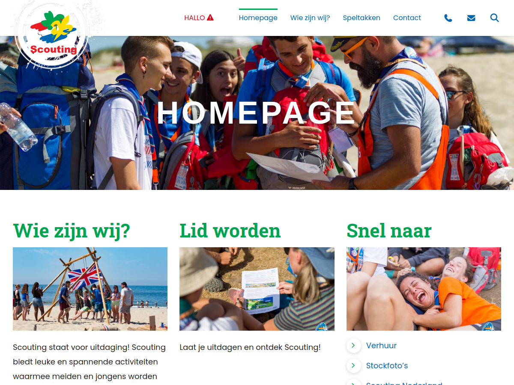

# Scouting Nederland WordPress Theme

[](https://github.com/scouting-nl/scouting-nederland-wordpress-theme/actions/workflows/build-test.yml)
[](https://github.com/scouting-nl/scouting-nederland-wordpress-theme/blob/main/LICENSE)

Een responsive classic theme voor WordPress-sites van Scoutinggroepen. Het theme biedt een configureerbare vormgeving, widgets, hero-secties, sliders en ondersteuning voor de WordPress block editor.

## Inhoud

- [Beschrijving](#beschrijving)
- [Screenshots](#screenshots)
- [Installatie](#installatie)
- [Instellingen](#instellingen)
- [Vertalingen](#vertalingen)
- [Veelgestelde vragen](#veelgestelde-vragen)
- [Beveiliging](#beveiliging)

## Beschrijving

Scouting Nederland is een classic theme met PHP-templates volgens de standaard WordPress-templatehiërarchie. Het werkt zelfstandig; aanvullende plugins zijn optioneel.

Het theme bevat onder andere:

- Responsive templates voor de homepage, pagina's, berichten, archieven, categorieën, zoekresultaten en 404-pagina's.
- Configureerbare hero en slider, met instellingen voor weergave per pagina.
- Widgetgebieden voor onder meer de hero, nieuwssectie, zijbalk en footer.
- Instellingen voor logo, kleuren, header, lettertypes en footer via de Customizer.
- `theme.json`-instellingen, editor-stijlen, block styles en een herbruikbaar block pattern.
- Reacties met threaded replies en paginering.

Het theme registreert zelf **geen aangepaste Gutenberg-blokken**. Scouting-specifieke blokken worden als afzonderlijke companion-plugin aangeboden en maken geen deel uit van het theme-pakket.

## Screenshots

### Themaweergave



## Installatie

1. Download het theme-ZIP-bestand via [GitHub Releases](https://github.com/scouting-nl/scouting-nederland-wordpress-theme/releases/latest).
2. Open in WordPress **Weergave > Thema's > Nieuw thema toevoegen > Thema uploaden**.
3. Upload het ZIP-bestand en activeer **Scouting Nederland**.
4. Wijs de hoofd- en footermenu's toe en pas de vormgeving aan via **Weergave > Customizer**.

Het theme vereist WordPress 7.0 of hoger en PHP 8.2 of hoger.

## Instellingen

Gebruik **Weergave > Customizer** om onder meer het logo, kleuren, header, standaard hero, lettertypes en footerinformatie in te stellen.

Per pagina kunnen aanvullende instellingen beschikbaar zijn voor de hero, paginatitel, zijbalk, hero-lettertype en slider.

## Optionele plugins

- [Scouting OpenID Connect](https://wordpress.org/plugins/scouting-openid-connect/) voegt aanmelden met Scouting Nederland toe.
- Scouting Nederland Blocks is een afzonderlijke companion-plugin voor Scouting-specifieke Gutenberg-blokken. Deze blokken zijn niet opgenomen in dit theme.

## Vertalingen

De bronteksten zijn Nederlands. Het vertaaltemplate staat in [languages/scouting-nederland-wordpress-theme.pot](languages/scouting-nederland-wordpress-theme.pot) en gebruikt het textdomain `scouting-nederland-wordpress-theme`.

De Engelse vertaling (`en_US`) staat in [languages/en_US.po](languages/en_US.po) en het bijbehorende gecompileerde MO-bestand. Kies **English (United States)** bij **Instellingen > Algemeen > Sitetaal** om deze vertaling te gebruiken.

Werk het template vanuit de repositoryroot bij met [WP-CLI](https://developer.wordpress.org/cli/commands/i18n/make-pot/):

```sh
wp i18n make-pot . languages/scouting-nederland-wordpress-theme.pot --domain=scouting-nederland-wordpress-theme --exclude=.github,.vscode,assets/vendor,scripts
```

Werk daarna de PO-bestanden bij met GNU gettext, bijvoorbeeld voor Engels:

```sh
msgmerge --update --backup=none --no-fuzzy-matching languages/en_US.po languages/scouting-nederland-wordpress-theme.pot
```

Vertaal nieuwe of gewijzigde teksten en compileer het MO-bestand opnieuw:

```sh
msgfmt --check --no-hash -o languages/en_US.mo languages/en_US.po
```

Maak voor een extra taal een PO-bestand op basis van het template. Plaats PO- en MO-bestanden in `languages/` met de locale als bestandsnaam, bijvoorbeeld `en_US.po` en `en_US.mo`.

De GitHub-check **Translation freshness** controleert of het POT-bestand nog overeenkomt met de bronteksten, alle PO-bestanden volledig vertaald zijn zonder fuzzy-markeringen en met geldige plaatsaanduidingen en meervoudsvormen, en de MO-bestanden opnieuw zijn gecompileerd. Generatiedatums en gewijzigde regelnummers veroorzaken geen foutmelding.

## Veelgestelde vragen

### Is dit een block theme?

Nee. Dit is een classic PHP theme met ondersteuning voor de block editor, editor-stijlen, block styles, een herbruikbaar pattern en instellingen in `theme.json`.

### Heb ik plugins nodig?

Nee. Het theme werkt zelfstandig. [Scouting OpenID Connect](https://wordpress.org/plugins/scouting-openid-connect/) en Scouting Nederland Blocks zijn optioneel en worden afzonderlijk geïnstalleerd.

### Bevat het theme Scouting Nederland-blokken?

Nee. Het theme registreert geen aangepaste bloktypen. Installeer daarvoor de afzonderlijke Scouting Nederland Blocks-plugin wanneer die voor je WordPress-installatie beschikbaar is.

### Werkt het theme met Elementor?

Het theme bevat enkele presentatie-aanpassingen voor Elementor-pagina's. Elementor zelf is niet vereist.

## Beveiliging

Meld vermoedelijke kwetsbaarheden privé volgens de [beveiligingsrichtlijnen](.github/SECURITY.md). Plaats geen kwetsbaarheidsdetails, geheimen, tokens of persoonsgegevens in openbare issues of discussies.
